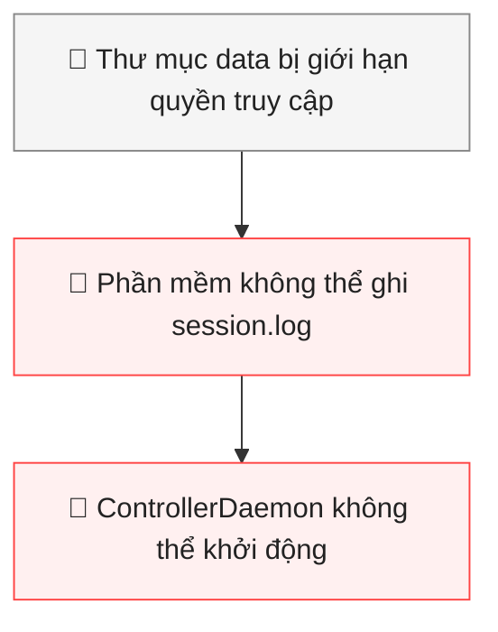

# Bài 9: Xây Dựng Prompt 3 Thành Phần Giải Mã Thông Báo Lỗi Trạm Sạc Cùng Trợ Lý AI
## Phần 1: Thiết kế Prompt 3 Thành phần Chuẩn hóa
### 1. Vì sao câu hỏi ngắn khiến AI đưa ra câu trả lời sai lệch?
Câu hỏi "AI ơi phần mềm trạm sạc của tôi bị hỏng rồi làm sao đây?" khiến AI đưa ra câu trả lời sai lệch vì thiếu thông tin cần thiết để xác định chính xác nguyên nhân sự cố.

Cụ thể, câu hỏi mắc 3 vấn đề:
- **Thiếu ngữ cảnh (Context):** Không nói rõ thiết bị đang gặp lỗi là trụ sạc VoltCharge số 04, hệ điều hành Windows 11 hay tác vụ mà phần mềm đang thực hiện.
- **Không cung cấp lỗi nguyên văn (Raw Error):** Không đưa nhật ký lỗi tiếng Anh nên AI không biết chương trình đang gặp lỗi gì.
- **Yêu cầu quá chung chung (Instruction):** Chỉ nói phần mềm bị hỏng mà không yêu cầu AI phân tích nguyên nhân hoặc đưa ra phương án khắc phục cụ thể.
### 2. Soạn thảo Prompt 3 thành phần hoàn chỉnh
Dưới đây là Prompt chuẩn hóa có thể sử dụng trực tiếp trên ChatGPT hoặc Gemini:

**[1. CONTEXT – NGỮ CẢNH]**

Tôi là nhân viên kỹ thuật đang trực vận hành hệ thống Kiosk nạp năng lượng thông minh VoltCharge tại Bến xe Miền Đông. Trụ sạc nhanh số 04 đột ngột dừng hoạt động. Thiết bị sử dụng hệ điều hành Windows 11 và phần mềm quản lý VoltCharge. Tôi đang kiểm tra nhật ký lỗi trên Terminal để tìm nguyên nhân sự cố.

**[2. RAW ERROR – LỖI NGUYÊN VĂN]**
```text
[TERMINAL ERROR LOG - VOLTCHARGE CHARGER #04]
2026-09-21 21:15:30 [FATAL] ControllerDaemon failed to start.
System.UnauthorizedAccessException:
Access to the path
'C:\Program Files\VoltCharge\data\session.log'
is denied.
at System.IO.FileStream.ValidateFileHandle(SafeFileHandle handle)
at VoltCharge.Core.SessionManager.Initialize()
InnerException: None.
Process terminated with exit code 5 (0x00000005).
Suggestion: Run the application with elevated
administrator privileges or verify NTFS file permissions.
```
**[3. INSTRUCTION – YÊU CẦU]**

Hãy thực hiện các yêu cầu sau:
1. Dịch thông báo lỗi tiếng Anh sang tiếng Việt đơn giản, dễ hiểu cho nhân viên kỹ thuật mới.
2. Phân tích nguyên nhân gốc rễ khiến phần mềm không thể khởi động.
3. Đưa ra 3 bước kiểm tra và khắc phục lỗi quyền truy cập trên Windows 11.
4. Ưu tiên giải pháp an toàn, không yêu cầu tháo vỏ trạm sạc hoặc can thiệp vào hệ thống điện.
5. Không tự suy đoán những thông tin không có trong nhật ký lỗi. Nếu thiếu dữ liệu, hãy nói rõ cần kiểm tra thêm thông tin gì.
6. Cảnh báo trước khi đề xuất các lệnh có thể ảnh hưởng đến hệ thống hoặc dữ liệu.
## Phần 2: Giải mã Lỗi & Kịch bản Khắc phục
### 3. Dịch và giải thích nguyên nhân gốc rễ
#### 3.1. Bản dịch thông báo lỗi
|Thông báo	|Ý nghĩa tiếng Việt|
|-|-|
|FATAL	|Lỗi nghiêm trọng|
|ControllerDaemon failed to start|	Dịch vụ điều khiển không thể khởi động|
|UnauthorizedAccessException|	Ngoại lệ do không có quyền truy cập|
|Access to the path is denied|	Hệ thống từ chối quyền truy cập vào đường dẫn|
|InnerException: None	|Không có lỗi nguyên nhân phụ được ghi nhận|
|Process terminated	|Tiến trình đã bị kết thúc|
|Exit code 5	|Mã lỗi 5 – Access is denied (Truy cập bị từ chối)|
|Run with elevated administrator privileges	|Chạy với quyền Quản trị viên|
#### 3.2. Giải thích nguyên nhân bằng ngôn ngữ đời thường
Hãy tưởng tượng thư mục `Program Files` giống như một căn phòng được khóa bảo vệ. Chỉ những người được cấp quyền mới có thể ghi hoặc chỉnh sửa dữ liệu bên trong.

Khi phần mềm VoltCharge khởi động, nó cần tạo hoặc ghi thông tin phiên hoạt động vào file:
```text
C:\Program Files\VoltCharge\data\session.log
```
Tuy nhiên, Windows phát hiện chương trình không có đủ quyền ghi dữ liệu vào vị trí này nên đã từ chối yêu cầu.

Điều đó khiến:
- ControllerDaemon không thể khởi động.
- SessionManager không thể khởi tạo phiên làm việc.
- Phần mềm bị dừng đột ngột với mã lỗi 5.
### Nguyên nhân gốc rễ

